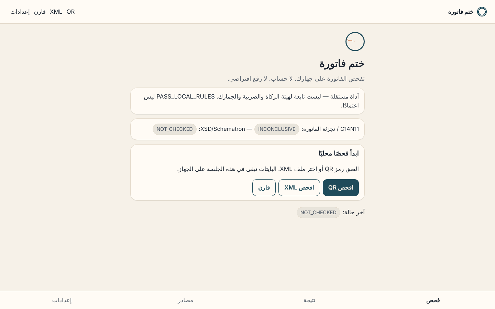
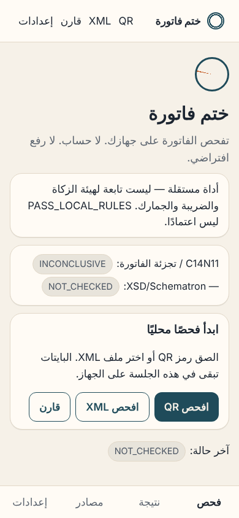

<div align="center">

# 🧾 Khatm Invoice — ختم فاتورة

**Local-first technical inspector for Saudi e-invoices (FATOORA): decode the QR, inspect the XML, cross-check totals — without uploading the invoice.**

<a href="https://github.com/tmrsa1-ui/Khatm-Invoice-Code/actions/workflows/ci.yml"></a>


<br><br>

<table><tr>
<td></td>
<td></td>
</tr></table>

[العربية](README.ar.md) · [Threat model](docs/threat-model.md) · [Privacy](PRIVACY.md) · [Security](SECURITY.md) · [Changelog](CHANGELOG.md)

</div>

---

Local-first technical inspector for Saudi electronic invoices (FATOORA).
Decode QR TLV, inspect XML, check totals, and compare QR fields with XML.

**Khatm Invoice is not affiliated with ZATCA and is not an official approval tool.**
A local pass means the invoice passed the rules this version actually ran.
It does not mean ZATCA accepted the invoice.

`PASS_LOCAL_RULES` is not «معتمدة». C14N11 / invoice hash stay `INCONCLUSIVE`.
XSD / Schematron stay `NOT_CHECKED` until the user supplies files outside git.

## What this version does

- Decode Base64 TLV QR (tags 1–9 catalog in a versioned ruleset)
- Require local tags 1–5, reject URL payloads, cap Base64 at 700
- Reject hostile XML (DOCTYPE / ENTITY / XXE / 2 MiB)
- Inspect UBL headers and selected totals
- Cross-check QR against XML when both exist
- Emit bilingual findings with evidence
- Run without an account and without uploading the invoice

## What this version does not do

- Generate invoices or QR codes for production use
- Sign, patch, or submit to FATOORA
- Bundle the official ZATCA SDK, XSD, or Schematron
- Declare a certificate trusted without Authority anchors
- Use the word “approved” / «معتمدة» as a result
- Claim C14N11 hash verification

## Quick start

Requires Node.js 20+.

```bash
# QR (official published sample)
node --experimental-strip-types apps/cli/src/index.ts qr \
  AQxCb2JzIFJlY29yZHMCDzMxMDEyMjM5MzUwMDAwMwMUMjAyMi0wNC0yNVQxNTozMDowMFoEBzEwMDAuMDAFBjE1MC4wMA==

# XML
node --experimental-strip-types apps/cli/src/index.ts xml tests/fixtures/xml/synthetic-minimal-wellformed.xml

# Compare
node --experimental-strip-types apps/cli/src/index.ts compare \
  --qr <base64-or-file> --xml <file.xml>

# Tests (44) and repo check
npm test
npm run lint

# Optional local schemas / SDK (never vendored)
# KHATM_SCHEMA_DIR + KHATM_SCHEMA_PINS + xmllint on the user's machine
node --experimental-strip-types apps/cli/src/index.ts schemas
node --experimental-strip-types apps/cli/src/index.ts sdk-status
```

Static PWA (no bundler):

```bash
python3 -m http.server 4173 --directory apps/web
```

Public HTTPS (GitHub Pages, `apps/web`, CSP via meta `connect-src 'none'`):

`https://tmrsa1-ui.github.io/Khatm-Invoice-Code/`

Enable once in the repository: **Settings → Pages → Source = GitHub Actions**.
The `pages` workflow cannot create the Pages site until that source is selected
(`Resource not accessible by integration`). CI tests stay independent of Pages.

## Result states

`PASS_LOCAL_RULES` `PASS_OFFICIAL_SDK` `FAILED` `WARNING` `INCONCLUSIVE` `NOT_CHECKED` `NOT_APPLICABLE` `UNSUPPORTED_RULESET`

`NOT_CHECKED` is not a pass. XSD and Schematron are `NOT_CHECKED` until official schemas are retrieved under license. C14N11 is `INCONCLUSIVE` until official fixtures prove the transform.

## Official sources

See `official-sources/manifest.json`. Active set:

- XML Implementation Standard v1.2 (2023-05-19)
- Data Dictionary (2023-05-19)
- Security Features Implementation Standards v1.2 (2023-05-19)
- QRCodeCreation.pdf (2021-11-18)

QR Base64 cap: 500 characters in the 2021 QR guide, **700** in Security Features v1.2. The active ruleset uses 700 and prints the version.

## License

Apache-2.0 for original project code.
